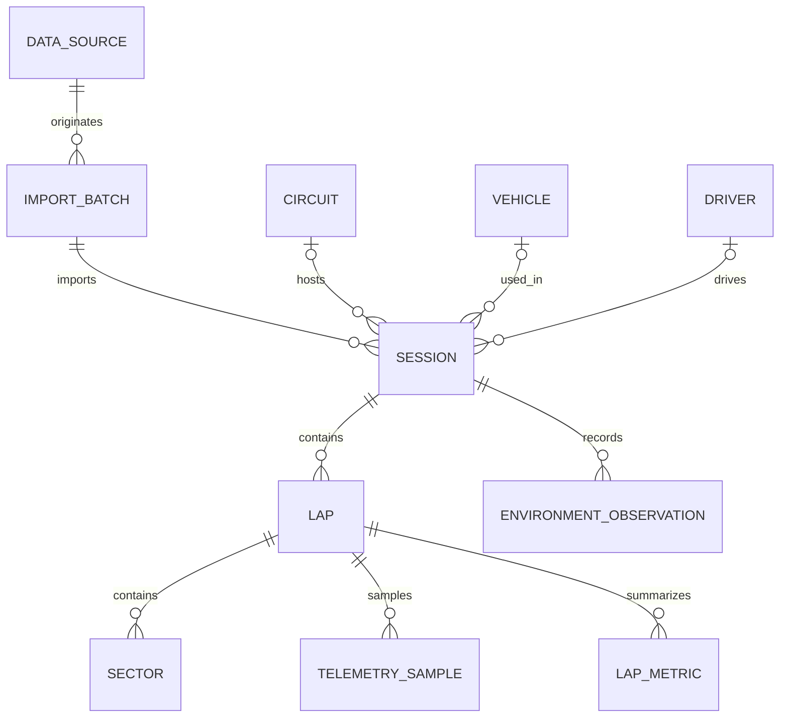

# Modelo de datos y normalización

Este documento separa el **modelo lógico de referencia** (útil para futuras importaciones persistentes) de los **contratos implementados** que actualmente sirven las pantallas. La aplicación no crea todavía tablas ni persiste muestras en PostgreSQL: los proveedores leen los archivos originales bajo demanda y proyectan sus datos a DTOs de la capa de aplicación.

## Granularidades representadas

Las fuentes disponibles no son equivalentes:

| Granularidad | Ejemplo | Uso actual |
|---|---|---|
| Muestra temporal asociada a una vuelta | JSON de F1, CSV de Assetto Corsa, CSV AiM | Gráficas y comparaciones alineadas por distancia. |
| Registro agregado por vuelta/sector | Hojas XLSX MotoGP | Evolución de tiempos, comparación de sectores y tablas; no permite inferir señales entre sectores. |
| Metadata de sesión/evento | Clima F1, metadata de vehículo, cabeceras de workbook | Contexto de las vistas, sin tratarlo como una señal temporal común. |

No se deben crear muestras sintéticas para rellenar una fuente agregada ni asumir que dos campos con el mismo nombre comparten unidad o significado.

## Modelo lógico de referencia

El siguiente modelo es una propuesta para una evolución con importación/persistencia; no describe un esquema físico existente.

Una implementación futura debería preservar fuente, versión de adaptador, identificadores externos, hash y ruta lógica de origen, número de filas aceptadas/rechazadas y advertencias. No almacenar payloads completos por defecto: conservar la procedencia y un medio de reproducir la transformación.

## Contratos que existen en la aplicación

Los registros de `src/RaceMind.Application/TelemetryContracts.cs` definen los resultados entregados por los proveedores:

- `TelemetryCatalog`, categorías, series, años, eventos y datasets para la navegación.
- `SessionDetails`, `DriverSummary`, `LapSummary`, `WeatherSummary` y `CornerSummary` para F1.
- `MotoGpSessionDetails`, `MotoGpRiderResult` y `MotoGpLapRecord` para tablas agregadas.
- `AssettoSessionDetails`, `AssettoLapSummary` y `AssettoTelemetrySample` para Assetto Corsa.
- `KartingSessionDetails`, `KartingLapSummary` y `KartingTelemetrySample` para AiM.
- Resultados de comparación específicos por fuente; no se fuerza un DTO universal que oculte diferencias de resolución.

El dominio común F1, en `RaceMind.Domain/TelemetrySample.cs`, usa tiempo transcurrido, distancia, distancia relativa, velocidad en km/h, acelerador porcentual y freno en fracción. El servicio de aplicación genera puntos interpolados; los proveedores de Assetto y karting exponen contratos propios y algoritmos específicos.

## Convenciones y calidad

### F1

- La comparación F1 ordena y alinea muestras por `rel_distance`; interpola linealmente dos vueltas sobre una rejilla uniforme (201 puntos por defecto en la interfaz).
- El delta de tiempo es comparada menos referencia; delta positivo implica que la vuelta comparada lleva más tiempo.
- La fuente observada entrega `throttle` en 0–100 y `brake` en 0–1. La respuesta comparada expone ambos como porcentajes.
- La velocidad se trata como km/h en la interfaz y los DTOs; la documentación de la fuente se debe consultar para certificar su unidad para cada conjunto.
- Los tiempos o sectores ausentes permanecen nulos. Las coordenadas de curva no deben confundirse con un vértice medido con exactitud.

### Assetto Corsa

- El CSV se procesa fila a fila. Las vueltas actuales se reconstruyen por cruces repetidos cerca del origen `pos_x/pos_z` (radio de 15 m), con más de 30 s entre cruces.
- Se descartan segmentos fuera de los límites implementados de duración (20–1200 s), distancia (500–100 000 m) y mínimo de muestras. Esto es una heurística para los datos actuales, no un marcador de vuelta universal.
- La distancia se suma desde posiciones cuando el intervalo temporal es positivo y no supera 0,2 s y el salto espacial no supera 15 m. La velocidad máxima de vuelta usa percentil 99 para limitar picos.
- Canales que faltan reciben valores de respaldo dentro del lector; la interfaz/comprobaciones de calidad intentan no presentar valores constantes como una medida disponible. Consultar las advertencias de la sesión antes de interpretar una señal.

### Karting AiM

- El export incluye líneas de metadata, nombres de canales, unidades y filas de muestra. `Beacon Markers` proporciona los límites de los segmentos.
- La longitud GPS se calcula con distancia geodésica cuando la precisión GPS y el número de satélites superan el filtro; en otros puntos se estima usando velocidad por tiempo.
- La clasificación de comparabilidad usa la ventana de tiempos/distancias y la mediana estable definida en el proveedor. La API devuelve las advertencias y la UI restringe la comparación a vueltas clasificadas como comparables.
- El adaptador valida tiempo, beacons, posición GPS y coherencia aproximada entre distancia y velocidad por tiempo.

### MotoGP

- El proveedor lee las hojas `Results` y `Laps` de cada XLSX. Los tiempos se conservan como cadenas del origen y se interpretan en la interfaz para calcular deltas y ritmos.
- No hay muestras temporales continuas en estos libros; no se alinean curvas de velocidad ni puntos de frenada.

## Evolución futura del esquema

Si se incorpora persistencia, una muestra canónica podría incluir vuelta, índice de orden, tiempo relativo y distancia en metros, con canales opcionales y definiciones de canal que expresen unidad, escala, eje, rueda y regla de transformación. Los agregados de vuelta deben conservar su granularidad y procedencia por separado de las muestras.

Reglas recomendadas:

1. Los valores desconocidos son nulos, distintos de cero, `false`, “no aplicable” y “no medido”.
2. Los adaptadores documentan conversión, referencia temporal, sistema de coordenadas, escalas y criterios de rechazo.
3. Se conserva la referencia al registro original y se informa de pérdidas o imputaciones.
4. Los hallazgos generativos reciben métricas seleccionadas y limitaciones, nunca telemetría en bruto.
5. La estrategia de almacenamiento se decide con volúmenes y consultas medidos; la tabla de canales/valores es una posibilidad, no una decisión tomada.
